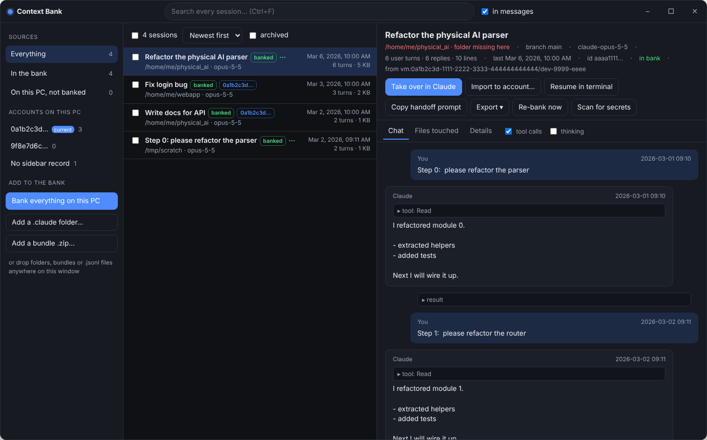

# Context Bank

A borderless desktop window that keeps **every Claude Code session on your PC in one local bank**,
lets you search through all of them, read each conversation, and **import any of them into any
Claude account on the machine** so Claude Desktop lists the session and continues from where it
stopped. It also builds a "handoff prompt" for the cases where a native resume is not possible.

Built on the on-disk layout documented by
[sxi9/claude-session-transfer](https://github.com/sxi9/claude-session-transfer); its bundle
format is used unchanged, so bundles move between the two tools in both directions.

```bash
cd context-bank
npm install        # only dependency: electron
npm start
npm test           # library tests against a throwaway store
npm run dist:win   # Windows: dist/builder/ContextBank-portable.exe (single file) + dist/ContextBank-win64.zip
node test/ui-smoke.js   # renders the UI in headless Chromium (needs playwright) and screenshots it
```



**Download the exe:** every build is published under
[Releases](https://github.com/sxi9/claude-session-transfer/releases) as `ContextBank-portable.exe`
(single file) and `ContextBank-win64.zip` (unpacked app), by the *Context Bank Windows build*
workflow. The exe is unsigned, so SmartScreen shows "More info" > "Run anyway" the first time.

## What it does

| Area | What you get |
|---|---|
| **Bank** | A local, account-independent copy of every session: sidebar record, transcript, custom title, subagent transcripts, project memory. Lives in `~/.context-bank/`. Survives sign-outs, account switches and deleted sidebar entries. |
| **Sources** | Everything Claude Desktop lists for every account, plus **orphan transcripts** in `~/.claude/projects` that no account points at. Also any folder you drop on the window (a copied `.claude` folder, a `projects` folder, a `claude-code-sessions` store from another PC, a USB stick) and any bundle `.zip`. |
| **claude.ai chats (Recents)** | The regular chats from Claude Desktop's and claude.ai's Recents list. Two ways in: *Sync Recents from claude.ai* with your browser session key (Settings), which pulls every chat and later only the ones that changed, or *Import a data export* (claude.ai Settings › Privacy › Export data, the zip or its conversations.json). Each chat becomes a Code-style transcript, so it is searched, read, imported and resumed like any session, and *Open on claude.ai* jumps to the original. |
| **Auto bank** | Every few minutes (default 5) changed sessions are banked again. Re-banking merges by message id, so nothing is lost when a session continues on either side. |
| **Search** | One box searches title, folder, first request, last reply, branch and model instantly, and, with *in messages* on, the full text of every conversation. Results show a highlighted snippet. |
| **Chat viewer** | Each session's conversation with user and Claude turns, collapsible tool calls, results and thinking blocks, the files it touched, and all the metadata. |
| **Import to account** | Pick any account and device on this PC, merge / overwrite / keep-existing, optional new sidebar id, remap the working folder when it does not exist here, include project memory. Dry run first. The device folder is backed up before every write. |
| **Take over in Claude** | One click: import into the current account and open Claude Desktop. |
| **Resume in terminal** | Opens a terminal in the working folder running `claude --resume <id>`. If the transcript is not on this PC yet, it is placed where the CLI looks for it first. |
| **Handoff prompt** | Copies a Markdown prompt with the session facts, original request, files touched, last turns and where it stopped, so a fresh chat in any account (desktop, CLI, claude.ai) can continue. |
| **Export** | Markdown, HTML, raw `.jsonl`, or a bundle `.zip` of selected sessions for another PC or account. Secret scan before sharing. |
| **Backups** | Every import backs up the target device folder first. List and restore from Settings. |

## Cloud sessions (the cloud icon in Recents)

Sessions started on claude.ai/code run in Anthropic's cloud, so their transcripts are not on
your PC and the folder scan cannot see them. Three ways to get them into the bank:

1. **Teleport them locally with Claude Code.** In a terminal, `claude --teleport` (or
   `/teleport` inside Claude Code) pulls a cloud session into the local CLI. Its transcript
   lands in `~/.claude/projects/`, and the bank picks it up on the next auto bank.
2. **Ask Claude for a bundle.** Any cloud session can read your other cloud sessions through
   its session tools. Ask it to export them as a Context Bank bundle, then use *Add a bundle
   .zip* or drop the file on the window. Each chat becomes a full transcript with every
   message, tool call and result, resumable with `claude --resume <id>` after import.
3. **Export from Claude Desktop** with the claude-session-transfer *Capture* page once the
   session has been opened locally.

A banked cloud session keeps the original `cloudSessionId` and a `cloudUrl` in its record, so
the Details tab links back to the claude.ai/code page.

## How "take over" works

Claude Desktop (Code tab) stores a sidebar record per session under its AppData folder and the
conversation as a `.jsonl` transcript under `~/.claude/projects/<cwd-slug>/`. A session
belongs to whichever account folder holds its record. Importing writes a record into the target
account's device folder and the transcript into the project folder, merging line by line if a
copy already exists. After restarting Claude Desktop, the session is in the sidebar of that
account, and the CLI can resume it with `claude --resume <id>`. Both read the full transcript,
so Claude continues with everything that was said before.

```
%APPDATA%\Claude\claude-code-sessions\<account>\<device>\local_<id>.json   sidebar record
~/.claude/projects/<cwd-slug>/<cliSessionId>.jsonl                        transcript
~/.claude/projects/<cwd-slug>/<cliSessionId>/                             title, subagents
~/.claude/projects/<cwd-slug>/memory/                                     project memory
```

macOS and Linux locations are handled too. `<cwd-slug>` is the working directory with every
non-alphanumeric character replaced by a dash.

## Bank layout

```
~/.context-bank/
  sessions/<cliSessionId>/record.json        sidebar record, real or synthesized
  sessions/<cliSessionId>/transcript.jsonl   merged transcript
  sessions/<cliSessionId>/extra/...          custom title, subagent transcripts
  sessions/<cliSessionId>/meta.json          summary used by list and search
  sessions/<cliSessionId>/text.txt           plain text for full-text search
  memory/<cwd-slug>/...                      project memory snapshots
  config.json                                labels, auto-bank, folders added
  trash/                                     removed sessions, by date
```

Set `CONTEXT_BANK_DIR` to put the bank elsewhere (a synced drive works). `CLAUDE_APP_DIR` and
`CLAUDE_HOME_DIR` point the app at another Claude store, as in claude-session-transfer.

## Layout of this folder

```
main.js              Electron main process: frameless window, IPC, terminal launch, auto bank
preload.js           the window.bank API exposed to the page
lib/claude.js        Claude's on-disk layout: discovery, transcript parsing, merge, install
lib/bank.js          the bank: store, search, bank from live / folder / bundle, export, import
lib/chats.js         claude.ai chats: data export parser, live pull, chat to transcript
lib/handoff.js       handoff prompt builder
lib/exporters.js     Markdown and HTML export
lib/secrets.js       secret scan
lib/zip.js           zip writer and reader, no dependencies
renderer/            the UI: index.html, style.css, app.js
test/bank.test.js    end-to-end tests on a temporary store
```

## If the exe does not open

The portable exe unpacks itself to a temp folder on every start, so the first launch can take
10 to 20 seconds with nothing on screen. If still nothing appears:

1. Check Task Manager for *Context Bank*. If it is there, the window is off screen or hidden:
   end it and start again.
2. Open a command prompt and run the exe from there; errors print to that window.
3. Look at `%APPDATA%\context-bank\startup.log`. Every start writes a line there, and a
   startup error also pops up a dialog.
4. Antivirus or SmartScreen may have quarantined it silently. The zip build, unpacked and run
   as `Context Bank.exe`, avoids the self-extracting step.

## Caveats

- The live chat sync calls the same undocumented endpoints the claude.ai web app uses, with
  your `sessionKey` cookie. They can change or be blocked; the data export route always works.
  The key is stored in the bank's config.json on this PC only. Clear it in Settings when done.
- A chat turned into a transcript holds only text turns. Resuming it with Claude Code gives
  Claude the whole conversation, but tools and artifacts from the web chat are text only.

- Relies on an undocumented on-disk layout. An app update could change it. Backups are written
  before every import.
- Close Claude Desktop before importing. It may overwrite the session list while open. The app
  warns and lets you continue anyway.
- Importing with *Merge* into an account that already has the session leaves both accounts
  pointing at the same transcript file. Continue it from both and the lines interleave into one
  file. Tick *new sidebar id* for a separate copy of the record, or export a bundle for a clean
  move to another machine.
- Never copy `.credentials.json` between accounts or machines; this app does not touch it.
- A handoff prompt carries conversation text. Run the secret scan before pasting it elsewhere.
